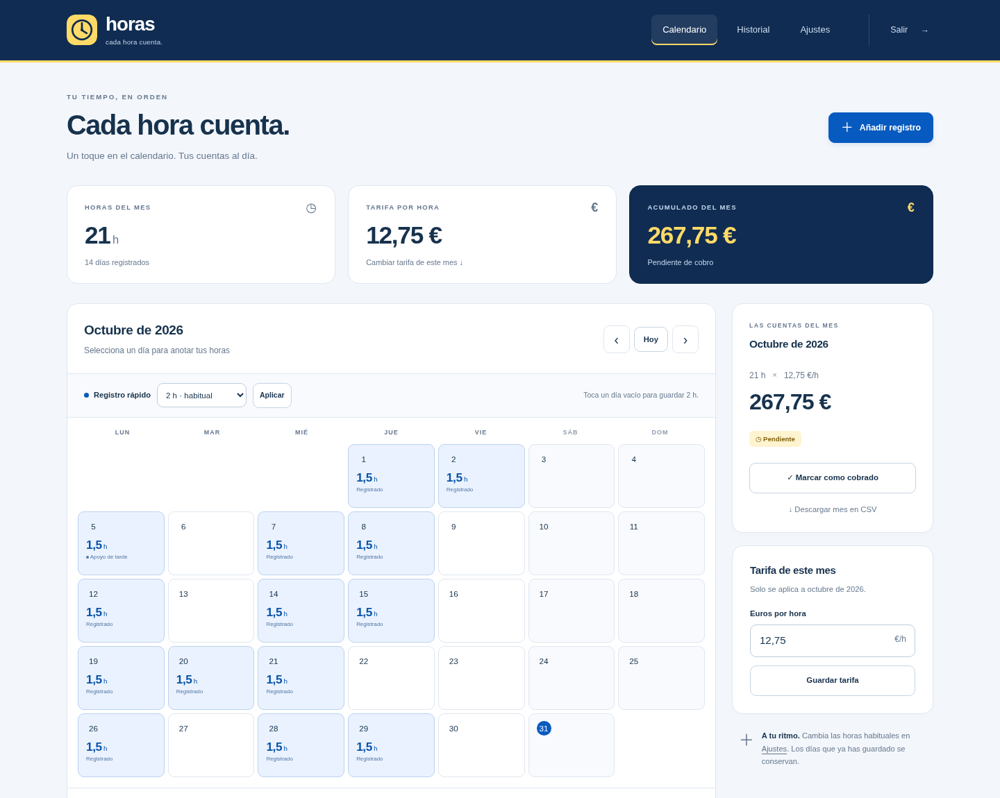

# Horas

Un calendario sencillo para registrar horas trabajadas y calcular la remuneración de cada mes. Interfaz en español, adaptable a móvil, sin servicios externos para funcionar.

## Qué puedes hacer

- **Un toque, un registro:** al abrir la aplicación aparece el mes actual. Toca un día vacío para guardar **2 horas** por defecto. Cambia esa cantidad en Ajustes o usa el selector de registro rápido.
- **Medias horas:** registra desde 0,5 hasta 24 horas por día, en intervalos de media hora. Toca un día guardado para editar las horas, añadir una nota o eliminarlo.
- **Tarifa por hora:** configura una tarifa habitual y ajusta la de un mes concreto desde su calendario.
- **Totales e historial:** consulta horas, días e importe acumulado por mes y año.
- **Control de cobros:** marca cada mes como cobrado o pendiente.
- **Exportación y copias:** descarga el mes en CSV y una copia completa en JSON, que puedes restaurar desde Ajustes.
- **Acceso con contraseña:** una contraseña compartida configurable durante el despliegue; no requiere registrar una cuenta.



[Vista móvil](docs/movil.png) · [Pantalla de acceso](docs/acceso.png)

## Desplegar con Dockhand

Hay dos formas de usar el repositorio:

### Stack creado pegando Compose

1. Crea un stack, por ejemplo `horas`.
2. Pega el contenido de [`compose.dockhand.yaml`](compose.dockhand.yaml) en el editor de Compose. Este archivo construye la imagen desde el archivo público del repositorio y no necesita un clon local.
3. En las variables del stack, añade `APP_PASSWORD` con una contraseña propia de **al menos 12 caracteres**. Opcionalmente configura `APP_PORT`; su valor por defecto es `8092`.
4. Despliega el stack con construcción de imagen habilitada. La primera vez necesita acceso a GitHub, al registro de imágenes de Docker y a PyPI.
5. Abre `http://<servidor>:8092` e introduce la contraseña que has configurado.

La base de datos y la clave de sesión quedan en el volumen persistente `horas_data` del stack. Docker aplica su prefijo de proyecto al nombre del volumen. No necesitas crear carpetas ni ajustar permisos manualmente.

### Stack conectado a Git

Configura el repositorio `https://github.com/kadyto/Horas`, la rama `main` y **`compose.yaml`** como archivo de Compose. Añade las mismas variables y despliega construyendo la imagen. Esta variante usa el código del checkout que gestiona Dockhand.

Al actualizar, conserva el nombre del stack y el volumen. En un stack pegado, vuelve a construir la imagen para descargar el archivo actualizado; si Dockhand reutiliza el contexto remoto, reconstruye sin caché. En un stack Git, sincroniza primero el repositorio y después reconstruye y recrea el servicio.

## Desplegar con Docker Compose

Necesitas Docker Engine y Docker Compose v2 con BuildKit.

```sh
git clone https://github.com/kadyto/Horas.git
cd Horas
cp .env.example .env
```

Edita `.env` y asigna una contraseña propia a `APP_PASSWORD`. Después:

```sh
docker compose up -d --build
```

Abre `http://localhost:8092`. Para consultar el estado y los registros:

```sh
docker compose ps
docker compose logs --tail=100 horas
```

Para actualizar:

```sh
git pull --ff-only
docker compose up -d --build
```

`docker compose down` conserva los datos. **`docker compose down -v` elimina el volumen y sus registros.**

## Configuración

| Variable | Valor por defecto | Uso |
| --- | --- | --- |
| `APP_PASSWORD` | Obligatoria | Contraseña de acceso, entre 12 y 1024 caracteres. Sin un valor válido, el servicio no arranca. |
| `APP_PORT` | `8092` | Puerto publicado en el servidor. |
| `COOKIE_SECURE` | `false` | Usa `true` cuando accedas exclusivamente mediante HTTPS; con HTTP local debe ser `false`. |
| `DATA_DIR` | `/data` en Docker | Directorio interno de la base de datos y la clave de sesión. Mantén el volumen montado en esa ruta. |

Para cambiar la contraseña, modifica `APP_PASSWORD` en las variables del stack o en `.env` y **recrea el servicio**. Las sesiones abiertas con la contraseña anterior quedarán invalidadas. No guardes contraseñas reales en el repositorio. Si una contraseña contiene `$`, configura el valor literal en el gestor de variables; en un archivo `.env` de Compose puedes usar comillas simples para evitar la interpolación.

Las horas habituales y la tarifa se configuran **dentro de la aplicación**, en Ajustes. La tarifa inicial es 0 €/h: configúrala al empezar para obtener importes. Un aviso en el calendario lo recuerda mientras siga a cero.

## Cómo se calculan los importes

- Hay **un registro por día**. Un segundo toque en el mismo día abre su edición; no suma otra jornada.
- Las horas se guardan como minutos enteros, y la tarifa como céntimos. No se acumulan errores de coma flotante.
- El total del mes es `minutos del mes × tarifa en céntimos ÷ 60`, redondeado al céntimo más próximo, con los medios céntimos hacia arriba. Por ejemplo, **3,5 h × 12,75 €/h = 44,63 €**.
- La tarifa habitual se copia al mes cuando se crea su primer registro o se guarda su tarifa. Después, ese mes conserva la tarifa aunque cambies la habitual. Al cambiar la tarifa de un mes se recalcula todo ese mes.
- El estado «cobrado» es una marca para seguimiento, no un registro de pagos parciales. Añadir o eliminar horas, modificar su cantidad o cambiar la tarifa devuelve el mes a pendiente. Editar únicamente una nota conserva el estado.
- El total del año suma los importes ya redondeados de sus meses.
- Los registros representan fechas, sin hora de entrada o salida. El mes que aparece al abrir depende de la fecha del servidor; la imagen usa UTC por defecto.

La aplicación está pensada para llevar el calendario de **una persona por despliegue**. El importe es un cálculo directo; no incluye impuestos, deducciones ni reglas de nómina.

## Copias y recuperación

En **Ajustes → Descargar copia JSON** puedes exportar todos los registros, tarifas, estados de cobro y preferencias. Guarda la copia en un lugar privado: contiene las notas y los importes. La contraseña y las sesiones no se incluyen.

Para restaurar, abre «Restaurar una copia», selecciona el JSON y escribe `RESTAURAR`. El archivo se valida completo antes de sustituir los datos en una transacción. Una copia inválida no modifica los registros. El límite de carga es 2 MB. Antes de una restauración válida se guarda también `before-restore.sqlite3` en el volumen; la siguiente restauración sustituye esa copia previa.

Para una copia del volumen a nivel de archivos, detén el servicio y guarda **todo el contenido de `/data`**, incluida `.session-key`. Conserva los archivos auxiliares de SQLite si existen. Para recuperar `before-restore.sqlite3`, detén el servicio, conserva una copia del volumen actual, sustituye `horas.sqlite3` por ese archivo y retira los antiguos `horas.sqlite3-wal` y `horas.sqlite3-shm` antes de arrancar. Mantén el propietario UID/GID `10001:10001`.

No elimines `.session-key`: permite mantener las sesiones entre reinicios. Si se pierde, genera una nueva clave arrancando con ese archivo ausente; los registros se conservarán y habrá que volver a iniciar sesión.

## Seguridad y funcionamiento

El contenedor funciona con un usuario sin privilegios, sistema de archivos de solo lectura, directorio temporal limitado y volumen de datos independiente. Usa SQLite con transacciones, restricciones de integridad y protección frente a ediciones obsoletas.

El acceso usa cookies firmadas `HttpOnly` y `SameSite=Lax`, formularios con token CSRF, comparación de contraseñas mediante hash scrypt y un límite persistente de diez intentos de acceso por dirección en quince minutos. La sesión caduca tras doce horas de inactividad. Detrás de un proxy, el límite se aplica a la dirección del proxy: no se confía en cabeceras reenviadas arbitrarias.

Si publicas el servicio fuera de una red de confianza, usa un proxy inverso con HTTPS y configura `COOKIE_SECURE=true`. El servicio escucha HTTP en el puerto interno 8000 y no gestiona certificados. No necesita acceso al socket Docker ni conexiones externas durante el uso. `/healthz` ofrece únicamente una comprobación de salud, sin datos privados.

## Desarrollo y pruebas

Python 3.12 o posterior:

```sh
python -m venv .venv
.venv/bin/pip install -r requirements-dev.txt
export APP_PASSWORD='solo-para-desarrollo-local'
export DATA_DIR='./data'
.venv/bin/flask --app 'app:create_app' run
```

Pruebas de autenticación, CSRF, concurrencia, calendario, importes, tarifas históricas, CSV, copias y persistencia:

```sh
.venv/bin/python -m pytest -q
docker build -t horas:test .
.venv/bin/python tests/smoke_docker.py
```

El repositorio incluye comprobaciones automáticas en GitHub Actions: pruebas de aplicación, validación de ambos Compose, construcción y una prueba real de la imagen con recreación del contenedor.

La prueba opcional `tests/browser_smoke.py` requiere Playwright y Chromium. Usa únicamente una instancia desechable: crea registros de ejemplo. Define `HORAS_TEST_URL`, `HORAS_TEST_PASSWORD` y, si es necesario, `CHROMIUM_PATH`. Comprueba el flujo de acceso, registro rápido, edición, cobros, historial, CSV y pantallas de 390, 360 y 320 píxeles. Las capturas se escriben en `test-results/`, que está excluido de Git.
